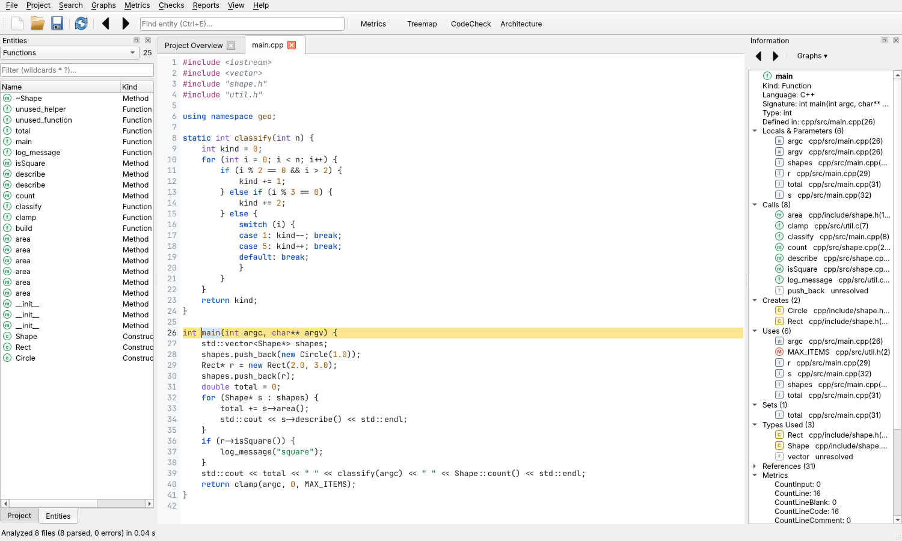
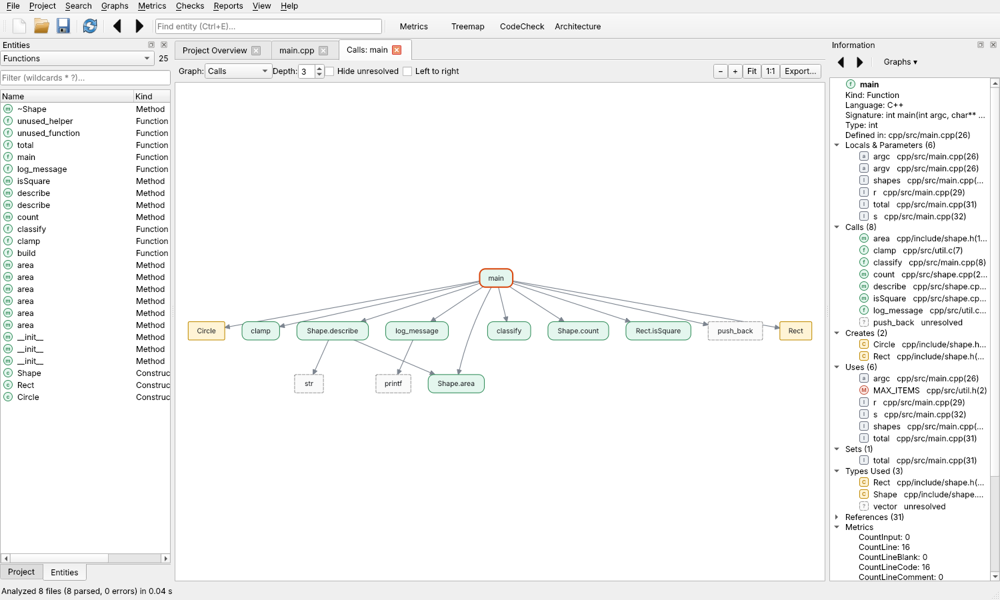
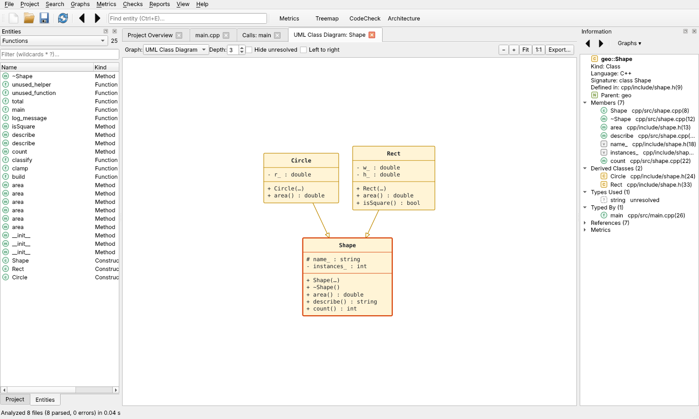
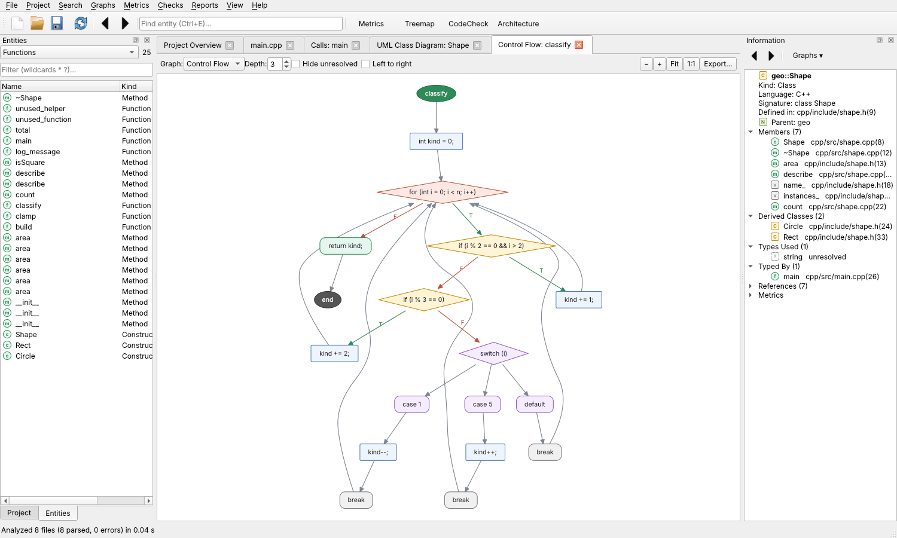
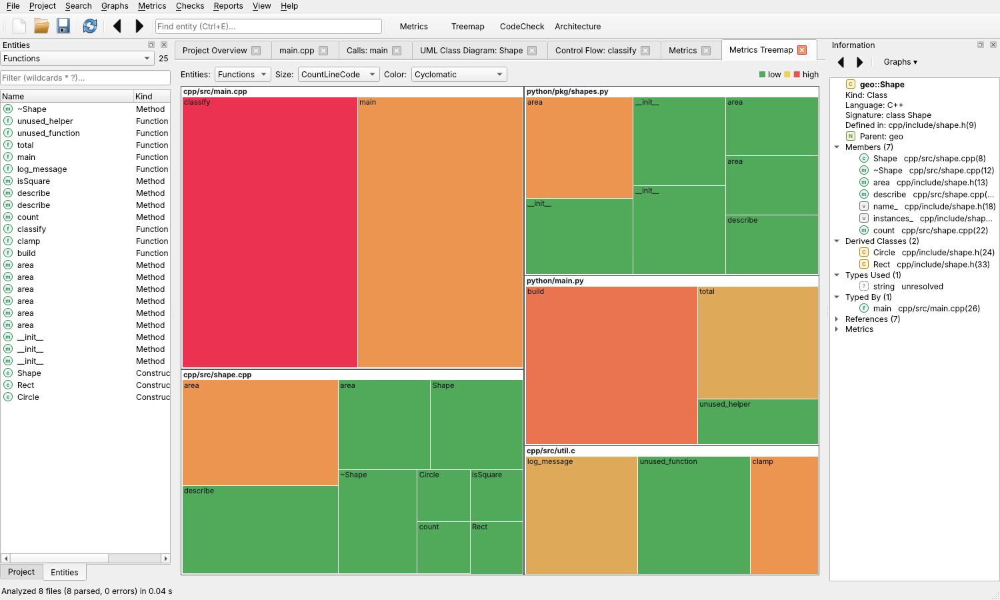
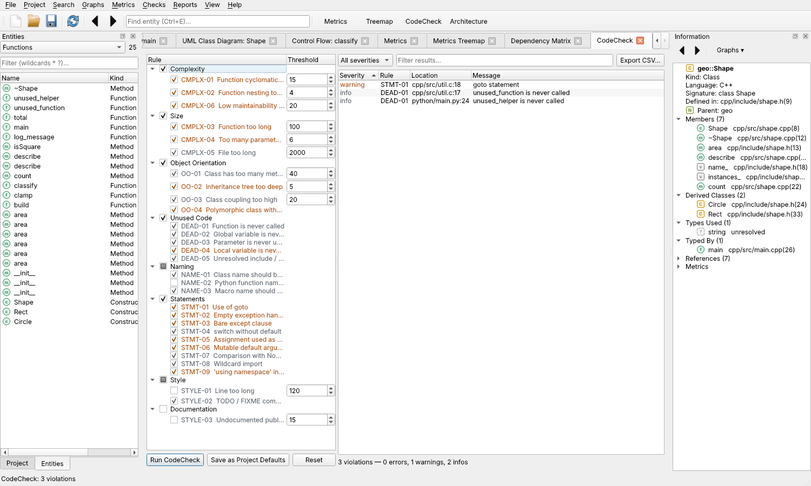
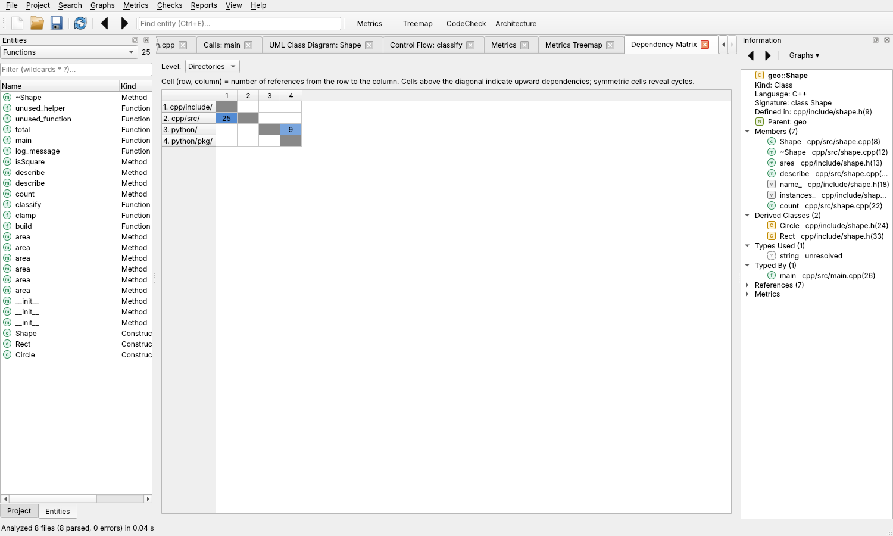

# CodeScope

CodeScope is a static source-code analysis and comprehension tool for **C, C++ and Python**, in the
spirit of SciTools *Understand*. It parses a code base into an entity/cross-reference database and lets
you browse, graph, measure and check it, from a desktop GUI or from the command line.



## Features

| Area | What you get |
|------|--------------|
| **Project database** | Analysis of whole source trees into a single SQLite project file (`.csdb`). Re-analysis is incremental (only changed files are parsed) and parsing runs in parallel. |
| **Entities** | Files, namespaces, classes, structs, unions, enums, enumerators, typedefs, macros, functions, methods, constructors, fields, globals, parameters and locals, with qualified names, signatures, modifiers and declared types. |
| **Cross references** | Calls, creates (instantiation), uses, sets, inheritance, type usage, `#include` and `import`. C/C++ declarations are merged with their definitions, and out-of-line methods (`Foo::bar`) are attached to their class. Member calls are resolved through `this`/`self`, declared or inferred variable types and base classes. Anything outside the project (e.g. `printf`, `<vector>`) becomes an *unresolved* entity. |
| **Information browser** | Every relationship of the selected entity: definition and declarations, members, calls / called-by, uses / used-by, base / derived classes, includes, all references, and metrics. |
| **Code editor** | Syntax highlighting, line numbers, find bar, highlighting of every occurrence of the selected entity, Ctrl+click / F12 *go to definition*, back/forward navigation, context menus with graphs, editing and saving. |
| **Graphs** | Call tree, called-by tree, butterfly, inheritance, UML class diagram, include / included-by, file dependencies, architecture (directory dependencies) and **control flow graphs**. All are interactive (click to inspect, double-click to open source, zoom, depth) and export to PNG, SVG or Graphviz DOT. |
| **Metrics** | Lines (code, comment, blank), comment ratio, McCabe cyclomatic complexity, max nesting, statements, parameters, fan-in/fan-out, Halstead volume/difficulty/effort, maintainability index, and for classes WMC, DIT, NOC, CBO and LCOM. Shown in a sortable metrics browser, a treemap, and exported as CSV. |
| **Dependency analysis** | Dependency structure matrix (DSM) at directory or file level, with dependency cycles highlighted. |
| **CodeCheck** | 30 configurable rules: complexity and size thresholds, OO design, dead code (uncalled functions, unused globals, parameters and locals), naming conventions, risky constructs (`goto`, empty handlers, bare `except`, assignment in conditions, missing `default`, mutable default arguments, …), style and documentation. |
| **Reports** | A self-contained HTML report: summary, data dictionary, cross-reference, metrics, CodeCheck results, graphs and browsable highlighted source. |
| **Command line** | `codescope` automates everything above for CI pipelines; `check --fail-on warning` returns a failing exit code. |

| | |
|---|---|
|  |  |
|  |  |
|  |  |

## Installing on Windows

Download either of these from the repository's **Releases** page, or from the artifacts of the
**Build** workflow run:

* `CodeScope-<version>-Setup.exe`: installer with Start-menu entries, optional desktop icon,
  `.csdb` file association and optional `PATH` entry for the command line tool.
* `CodeScope-<version>-portable.zip`: unzip anywhere and run `CodeScope.exe`.

Both contain `CodeScope.exe` (the GUI) and `codescope-cli.exe` (the console tool). No Python
installation is needed.

### Building the Windows package yourself

On a Windows machine with Python 3.10+ (and optionally [Inno Setup 6](https://jrsoftware.org/isinfo.php)):

```powershell
powershell -ExecutionPolicy Bypass -File packaging\build_windows.ps1
```

This produces `dist\CodeScope\` (portable folder), the portable zip and, if Inno Setup is installed,
the installer. The GitHub Actions workflow `.github/workflows/build.yml` does the same on every push:
it runs the tests on Windows, builds with PyInstaller, smoke-tests the frozen executables, builds the
installer and uploads both packages. Pushing a tag `v*` also publishes them as a GitHub release.

## Running from source (any OS)

```bash
pip install -r requirements.txt
```

```bash
python -m codescope
```

`python -m codescope` with no arguments starts the GUI; with arguments it runs the command line tool.

## Using the GUI

1. **File → New Project…**: pick the source directories, the languages, how `.h` files are parsed,
   and exclude patterns. The project is analyzed immediately.
2. Browse with the **Project** tree (files and their outlines) or the **Entities** filter (by kind,
   with wildcard filtering). Select an entity to show it in the **Information** browser; double-click to open its source.
3. In the editor, **Ctrl+click** or **F12** jumps to a definition and **Alt+Left/Right** navigates back
   and forward. Right-click shows entity menus with all applicable graphs.
4. **Metrics**, **Checks** and **Reports** menus open the metrics browser / treemap / dependency matrix,
   CodeCheck and the HTML report generator.
5. After editing code, press **F5** to re-analyze changed files.

## Command line

```text
codescope create  proj.csdb -r src -r include [-l c cpp python] [-x "*/third_party/*"] [-a]
codescope add     proj.csdb more_src/
codescope analyze proj.csdb [--full]
codescope list    proj.csdb -k class function [-n "geo::*"]
codescope info    proj.csdb geo::Rect::area
codescope metrics proj.csdb -k function -o metrics.csv      (or --project for totals as JSON)
codescope check   proj.csdb [--rules "DEAD-*" CMPLX-01] [-t CMPLX-01=10] [-f text|csv|json] [--fail-on warning]
codescope check   --list-rules
codescope graph   proj.csdb main -t calls|callby|butterfly|inheritance|uml|includes|control -o main.svg
codescope graph   proj.csdb -t architecture -o arch.dot
codescope report  proj.csdb -o report/
codescope gui     [proj.csdb]
```

On Windows the console tool is called `codescope-cli.exe`.

## Project settings

Settings are stored inside the project database and can be changed in **Project → Configure** or with
`codescope settings`:

* `roots`: source directories
* `languages`: any of `c`, `cpp`, `python`
* `exclude`: glob patterns matched against absolute paths (e.g. `*/build/*`)
* `header_lang`: `auto`, `c` or `cpp` (how `.h` files are parsed)
* `ignore_macros`: extra annotation macros to ignore while parsing. Export macros such as
  `#define FOO_API __declspec(dllexport)` and `class FOO_API Widget` are detected automatically.
* `codecheck`: enabled rules and thresholds (saved from the CodeCheck panel)

## Architecture

```text
codescope/
  core/                 analysis engine (no GUI dependency)
    languages.py        file type -> tree-sitter grammar
    extract/            per-language extractors: entities, references, metrics
    analyzer.py         scanning, incremental + parallel parsing, macro scrubbing
    database.py         SQLite project database and query API
    resolver.py         project-wide linking and name resolution
    metrics.py          OO / coupling metrics computed after linking
    cfg.py              control flow graphs
    graphs.py layout.py svg.py   graph builders, layered layout, SVG/DOT export
    codecheck.py        rules engine
    report.py           HTML report and CSV export
  gui/                  PySide6 desktop application
  cli.py                command line interface
packaging/              PyInstaller spec, Inno Setup script, Windows build script
tests/                  pytest suite with sample C/C++ and Python projects
```

Parsing uses [tree-sitter](https://tree-sitter.github.io/) grammars, so it is fast and tolerant of
code that does not compile. Like Understand's default "fuzzy" parser, CodeScope does not run the C
preprocessor. Macros are recorded as entities, and annotation macros are blanked out before parsing.

## Development

```bash
pip install -r requirements.txt pytest pyinstaller
```

```bash
python -m pytest
```

```bash
python scripts/make_icon.py
```

The first command installs the development dependencies, the second runs the tests and the third
regenerates `codescope/resources/codescope.ico` and `.png`. GUI tests run headless with
`QT_QPA_PLATFORM=offscreen`.
