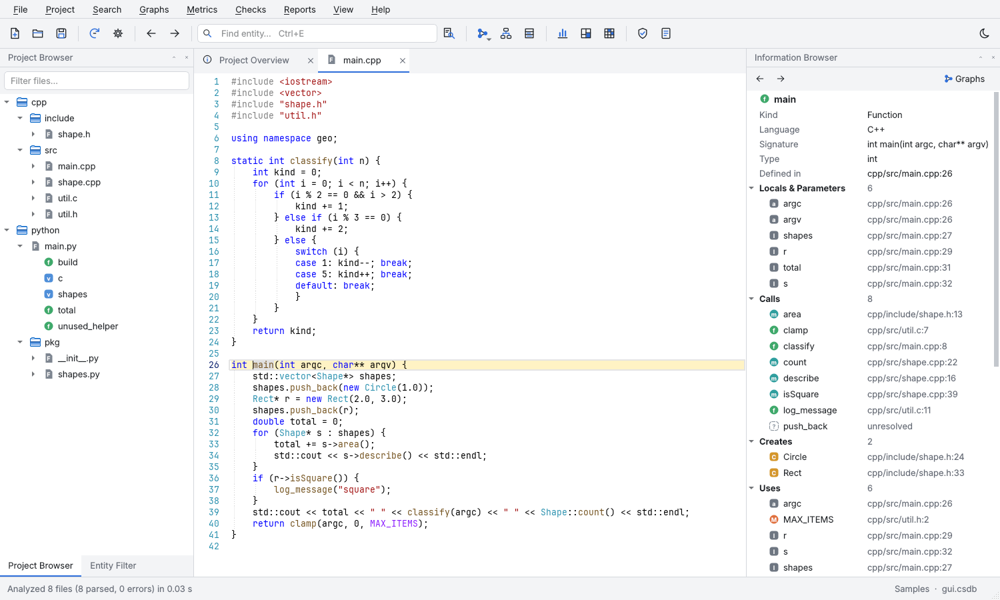
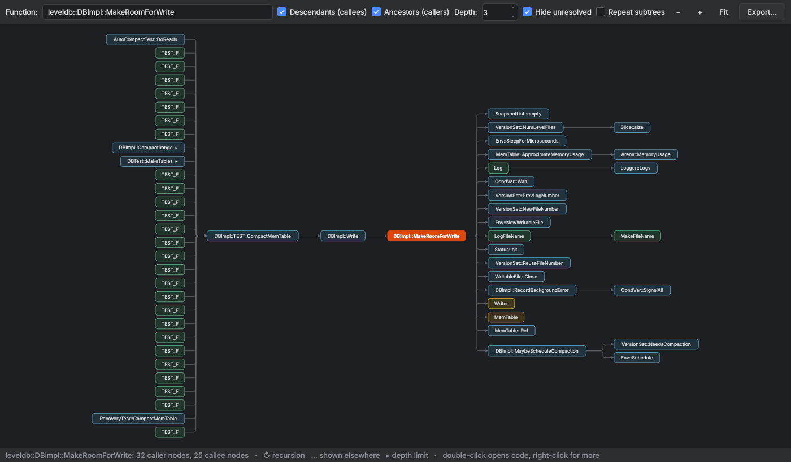
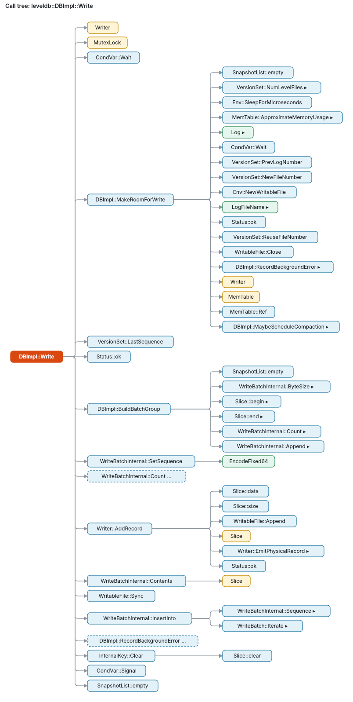
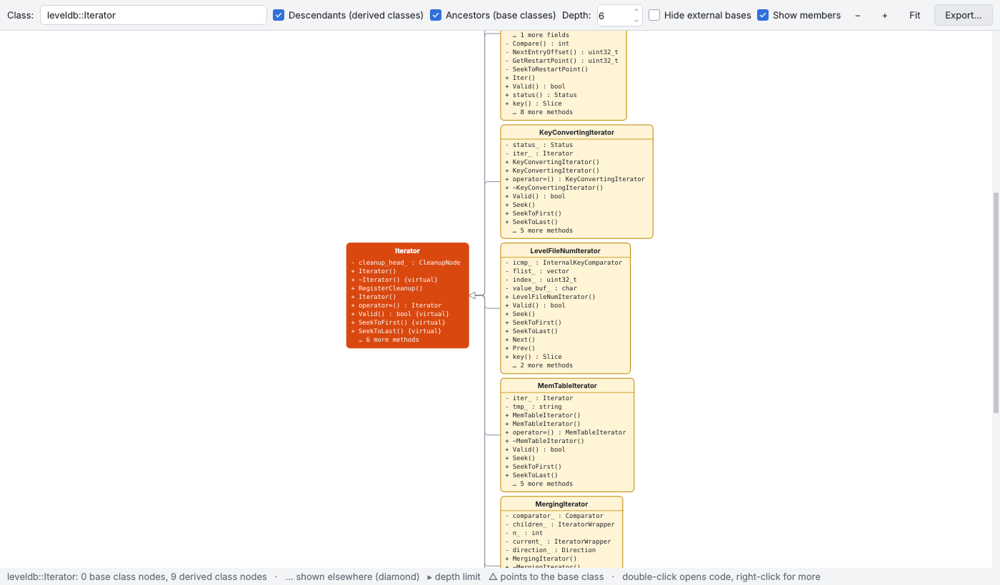
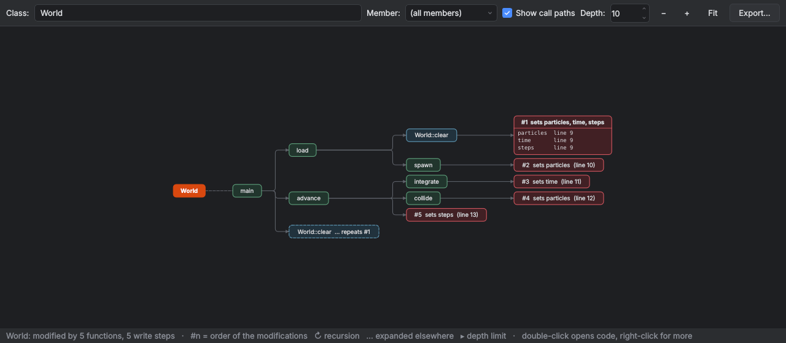
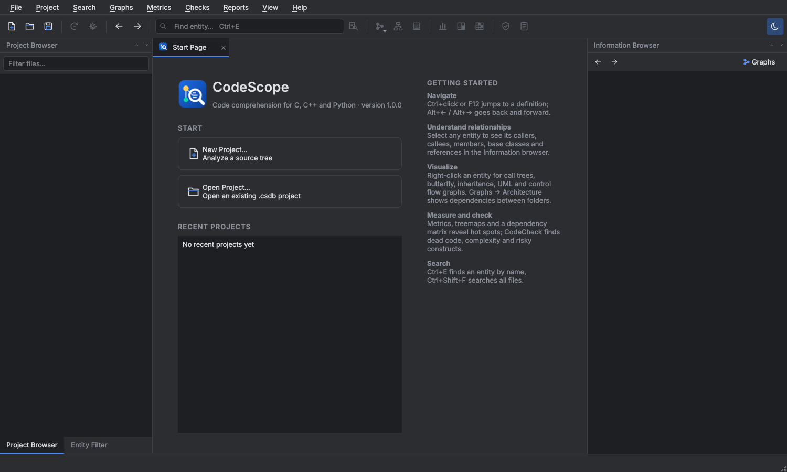
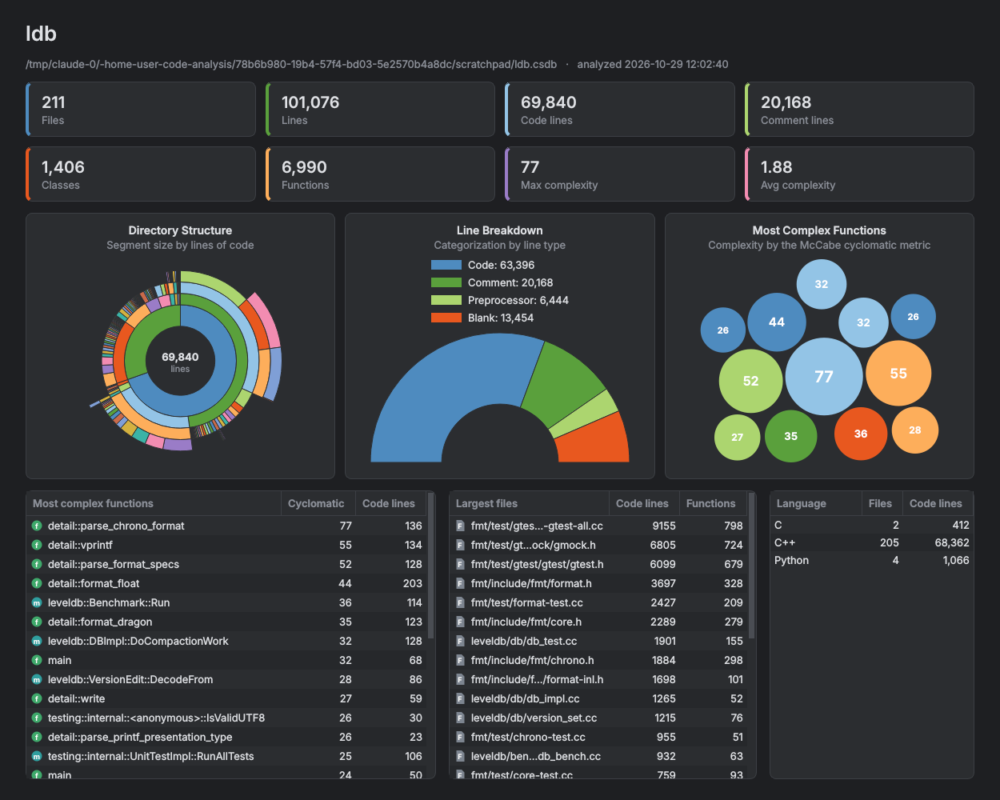

# CodeScope

CodeScope is a static source-code analysis and comprehension tool for **C, C++ and Python**, in the
spirit of SciTools *Understand*. It parses a code base into an entity/cross-reference database and lets
you browse, graph, measure and check it, from a desktop GUI or from the command line.


The interface uses a dark theme by default, inspired by Understand's workspace. A light theme is one
click away (moon icon, or **View → Dark Theme**).



## Features

| Area | What you get |
|------|--------------|
| **Project database** | Analysis of whole source trees into a single SQLite project file (`.csdb`). Re-analysis is incremental (only changed files are parsed) and parsing runs in parallel. |
| **Entities** | Files, namespaces, classes, structs, unions, enums, enumerators, typedefs, macros, functions, methods, constructors, fields, globals, parameters and locals, with qualified names, signatures, modifiers and declared types. |
| **Cross references** | Calls, creates (instantiation), uses, sets, inheritance, type usage, `#include` and `import`. C/C++ declarations are merged with their definitions, and out-of-line methods (`Foo::bar`) are attached to their class. Member calls are resolved through `this`/`self`, declared or inferred variable types and base classes. Anything outside the project (e.g. `printf`, `<vector>`) becomes an *unresolved* entity. |
| **Information browser** | Every relationship of the selected entity: definition and declarations, members, calls / called-by, uses / used-by, base / derived classes, includes, all references, and metrics. |
| **Code editor** | Visual Studio 2022 look: VS Light / VS Dark colour schemes, Cascadia Mono / Consolas, teal line numbers, framed current line and dotted indent guides. Highlighting uses tree-sitter plus semantic colouring from the analysis (types, functions, macros and enumerators coloured by what they resolve to). Ctrl+wheel zoom, configurable font. Also: line numbers, find bar, highlighting of every occurrence of the selected entity, Ctrl+click / F12 *go to definition*, back/forward navigation, context menus with graphs, editing and saving. Files changed by another program (Visual Studio, git, …), open or not, are detected and re-analyzed in the background (**Project → Watch Files for Changes**); open files reload, and unsaved edits are never overwritten without asking. |
| **Graphs** | Call tree, called-by tree, butterfly, inheritance, UML class diagram, include / included-by, file dependencies, architecture (directory dependencies) and **control flow graphs**. All are interactive: click a node to highlight its connections, double-click to open source, find nodes by name, zoom, and change the depth or folder level. Large dependency graphs show only their strongest edges, drawn thicker by weight. Graphs export to PNG, SVG or Graphviz DOT. |
| **Call trees** | **Graphs → Call Tree** (Ctrl+Shift+T): pick a function and tick **Descendants** (what it calls), **Ancestors** (what calls it) or both. Every call path becomes its own branch with callees in source order, recursion (↻) and repeated subtrees (…) marked, and a depth limit (▸). A tidy layout puts callers on the left and callees on the right, joined by orthogonal connectors. Double-click to open code, right-click for the call site, re-rooting or collapsing a branch. Exports to SVG, PNG or indented text (`codescope calltree`). |
| **Class trees** | **Graphs → Class Tree** (Ctrl+Shift+H): pick a class or struct and tick **Descendants** (member types and derived classes), **Ancestors** (base classes and the classes that contain it) or both. Choose **Inheritance**, **Composition** or both: composition follows data members through `std::vector`, smart pointers, `std::optional` and typedefs, labelled `links[] : Link`, `storage_* : Builder`, so a struct without base classes still shows its whole structure. Ancestors go to the left and descendants to the right, with UML triangles (inheritance) and diamonds (composition). Shared parts are shown once and marked (…). **Members (data + functions)** lists every data member and member function as its own node (`+ links[] : LinkT`, `+ nq() : Size`, `- storage_* : ModelBuilderT`), and data members of project types expand into their own members, level by level; on the ancestor side only the direct base classes and direct containers are shown. **Show members** turns every box into a UML card with fields and methods. Exports to SVG, PNG or text (`codescope classtree`). |
| **Modification trees** | **Graphs → Modification Tree** (Ctrl+Shift+M): pick a class or struct, and optionally one member, to see where and in which order it is modified. The tree starts at the entry points (e.g. `main`) and follows only the calls that lead to a write. Calls and writes appear in source order, so reading the tree top to bottom gives the order of the modifications, numbered #1, #2, … Writes include assignments, `++`/`+=`, member chains (`a.b[i].c = x`), container and smart-pointer members (`links[i].mass`, `storage_->links`) and mutating calls such as `push_back`, `clear` or `append`. **Whole-object writes** also count assignments that replace the object as a whole, e.g. `world.options = other` when the struct is held by value in a field (nested holders included), shown as *replaces options.settings*. Untick **Show call paths** for a flat list of the modifying functions. Double-click a write to open it. Exports to SVG, PNG or text (`codescope modtree`). |
| **Field trees** | **Graphs → Field Tree** (Ctrl+Shift+L), or right-click a field: pick one field, e.g. `JointT.damping`, to see its whole life as one tree. The first branch is the declaration with its default value. The other branches are the call paths, from the entry points, to each step, numbered #1, #2, … in source order: *creates* (an object that holds the field: `JointT j;`, `JointT{}`, `new JointT`, `make_unique<JointT>()`, also through derived classes and typedefs), *stores* (the object goes into a container: `joints.push_back(j)`), *sets* and *replaces*. Writes that happen through a call are also found and named: a field passed to a non-const reference or pointer parameter (*sets damping through convertScalar()*), and a field written through a returned reference (`authoredJointDofField(j, c) = value`). Writes through a local alias are followed too: `auto& d = j.damping; d = 1;`, `double* p = &j.damping; *p = 1;`, `auto& j = joints[i]; j.damping = 1;`, `for (auto& j : joints) j.damping = 1;` and `auto& d = field(j); d = 1;` (*sets damping through d*). A non-const parameter counts as a write even if the function only reads it, and a pointer keeps every target it was given in the function, because a branch may not have run. Not followed: aliases kept outside the function (in a member or a global), pointers obtained from a call (`double* p = get(j);`), lambda parameters used as aliases; overloads are not chosen by argument type. Exports to SVG, PNG or text (`codescope fieldtree`). |
| **Metrics** | Lines (code, comment, blank), comment ratio, McCabe cyclomatic complexity, max nesting, statements, parameters, fan-in/fan-out, Halstead volume/difficulty/effort, maintainability index, and for classes WMC, DIT, NOC, CBO and LCOM. Shown in a sortable metrics browser, a treemap, and exported as CSV. |
| **Dependency analysis** | Dependency structure matrix (DSM) at directory or file level, with dependency cycles highlighted. |
| **CodeCheck** | 30 configurable rules: complexity and size thresholds, OO design, dead code (uncalled functions, unused globals, parameters and locals), naming conventions, risky constructs (`goto`, empty handlers, bare `except`, assignment in conditions, missing `default`, mutable default arguments, …), style and documentation. |
| **Dashboard** | The Project Overview shows key totals plus Understand-style charts: a directory-structure sunburst sized by lines of code, a line breakdown (code, comment, preprocessor and blank lines) and a bubble chart of the most complex functions. |
| **Reports** | A self-contained HTML report: summary, data dictionary, cross-reference, metrics, CodeCheck results, graphs and browsable highlighted source. |
| **Command line** | `codescope` automates everything above for CI pipelines; `check --fail-on warning` returns a failing exit code. |

| | |
|---|---|
|  |  |
|  |  |
|  |  |
|  |  |
|  |  |
|  |  |

## Installing on Windows

Download either of these from the repository's **Releases** page, or from the artifacts of the
**Build** workflow run:

* `CodeScope-<version>-Setup.exe`: installer with Start-menu entries, optional desktop icon,
  `.csdb` file association and optional `PATH` entry for the command line tool.
* `CodeScope-<version>-portable.zip`: unzip anywhere and run `CodeScope.exe`.

Both contain `CodeScope.exe` (the GUI) and `codescope-cli.exe` (the console tool). No Python
installation is needed.

### Building the Windows package yourself (one click)

1. Clone the repository on a Windows PC.
2. Double-click **`build.bat`** in the repository root.

The build takes a few minutes the first time and then opens the `dist` folder, which contains:

* `dist\CodeScope\CodeScope.exe`: the application, ready to run
* `dist\CodeScope-<version>-portable.zip`
* `dist\CodeScope-<version>-Setup.exe`: the installer

The script takes care of everything it needs:

* It finds Python 3.10+. If none is installed, it offers to install it with `winget`.
* It creates a private build environment in `.build-venv\`, so your global Python is untouched.
* It installs the dependencies, runs the tests, builds with PyInstaller and smoke-tests the result.
* It builds the installer with Inno Setup 6, offering to install Inno Setup via `winget` if it is missing.
  Without Inno Setup you still get the portable folder and zip.

Options can be given from a command prompt, e.g. `build.bat -SkipTests`:

| Option | Effect |
|--------|--------|
| `-SkipTests` | Skip the test suite (faster) |
| `-SkipInstaller` | Build only the portable folder and zip |
| `-Clean` | Delete `.build-venv`, `build` and `dist` first |
| `-Yes` | Accept the winget install prompts automatically |
| `-NoPause` | Do not wait for a key press at the end (for scripts/CI) |

The GitHub Actions workflow `.github/workflows/build.yml` runs `build.bat` on every push. It also builds
and uploads the packages, and pushing a tag `v*` publishes them as a GitHub release.

## Running from source (any OS)

```bash
pip install -r requirements.txt
```

```bash
python -m codescope
```

`python -m codescope` with no arguments starts the GUI; with arguments it runs the command line tool.

## Using the GUI

1. **File → New Project…**: click **Add Folder…** and pick your project folder. CodeScope scans
   all of its subdirectories and shows them as a checkable tree with file counts under
   **Folders to analyze**. Tick only the folders that contain your own code, e.g. `src` and `include`.
   Folders that look like third-party code or build output (`third_party`, `external`, `vendor`,
   `deps`, `build`, …) start unticked; **Own Code Only**, **All** and **None** reset the ticks.
   Choose the languages and how `.h` files are parsed, then press OK and the project is analyzed.
   You can change the folder selection later in **Project → Configure Project**.
2. Browse with the **Project** tree (files and their outlines) or the **Entities** filter (by kind,
   with wildcard filtering). Select an entity to show it in the **Information** browser; double-click to open its source.
3. In the editor, **Ctrl+click** or **F12** jumps to a definition and **Alt+Left/Right** navigates back
   and forward. Right-click shows entity menus with all applicable graphs.
4. **Metrics**, **Checks** and **Reports** menus open the metrics browser / treemap / dependency matrix,
   CodeCheck and the HTML report generator.
5. After editing code, press **F5** to re-analyze changed files.

## Command line

```text
codescope create  proj.csdb -r MyEngine -f src -f include [-l c cpp python] [-a]
codescope create  proj.csdb -r MyEngine --own-code -a      (skip third_party/, build/, ...)
codescope settings proj.csdb -f src -f include             (change the folder selection; --all-folders resets)
codescope add     proj.csdb more_src/
codescope analyze proj.csdb [--full]
codescope list    proj.csdb -k class function [-n "geo::*"]
codescope info    proj.csdb geo::Rect::area
codescope metrics proj.csdb -k function -o metrics.csv      (or --project for totals as JSON)
codescope check   proj.csdb [--rules "DEAD-*" CMPLX-01] [-t CMPLX-01=10] [-f text|csv|json] [--fail-on warning]
codescope check   --list-rules
codescope graph   proj.csdb main -t calls|callby|butterfly|inheritance|uml|includes|control -o main.svg
codescope graph   proj.csdb -t architecture -o arch.dot
codescope classtree proj.csdb geo::Shape --members -o classes.svg     (--up / --down; -r inherit|compose|both|members)
codescope calltree proj.csdb geo::Shape::describe --down --up -d 4 -o tree.svg   (or print as text)
codescope modtree proj.csdb World [-m particles] [--flat] [--no-whole] -o world.svg   (or World::particles)
codescope fieldtree proj.csdb JointT.damping [--flat] [--no-whole] [--no-creations] -o damping.svg
codescope report  proj.csdb -o report/
codescope gui     [proj.csdb]
```

On Windows the console tool is called `codescope-cli.exe`.

## Project settings

Settings are stored inside the project database and can be changed in **Project → Configure** or with
`codescope settings`:

* `roots`: project folders
* `folders`: the sub folders to analyze (empty means everything under `roots`)
* `languages`: any of `c`, `cpp`, `python`
* `exclude`: glob patterns matched against absolute paths (e.g. `*/build/*`)
* `header_lang`: `auto`, `c` or `cpp` (how `.h` files are parsed)
* `ignore_macros`: extra annotation macros to ignore while parsing. Export macros such as
  `#define FOO_API __declspec(dllexport)` and `class FOO_API Widget` are detected automatically.
* `codecheck`: enabled rules and thresholds (saved from the CodeCheck panel)

## Architecture

```text
codescope/
  core/                 analysis engine (no GUI dependency)
    languages.py        file type -> tree-sitter grammar
    extract/            per-language extractors: entities, references, metrics
    analyzer.py         scanning, incremental + parallel parsing, macro scrubbing
    database.py         SQLite project database and query API
    resolver.py         project-wide linking and name resolution
    metrics.py          OO / coupling metrics computed after linking
    cfg.py              control flow graphs
    graphs.py layout.py svg.py   graph builders, layered layout, SVG/DOT export
    codecheck.py        rules engine
    report.py           HTML report and CSV export
  gui/                  PySide6 desktop application
  cli.py                command line interface
packaging/              PyInstaller spec, Inno Setup script, Windows build script
tests/                  pytest suite with sample C/C++ and Python projects
```

Parsing uses [tree-sitter](https://tree-sitter.github.io/) grammars, so it is fast and tolerant of
code that does not compile. Like Understand's default "fuzzy" parser, CodeScope does not run the C
preprocessor. Macros are recorded as entities, and annotation macros are blanked out before parsing.

## Development

```bash
pip install -r requirements.txt pytest pyinstaller
```

```bash
python -m pytest
```

```bash
python scripts/make_icon.py
```

The first command installs the development dependencies, the second runs the tests and the third
regenerates `codescope/resources/codescope.ico` and `.png`. GUI tests run headless with
`QT_QPA_PLATFORM=offscreen`.
